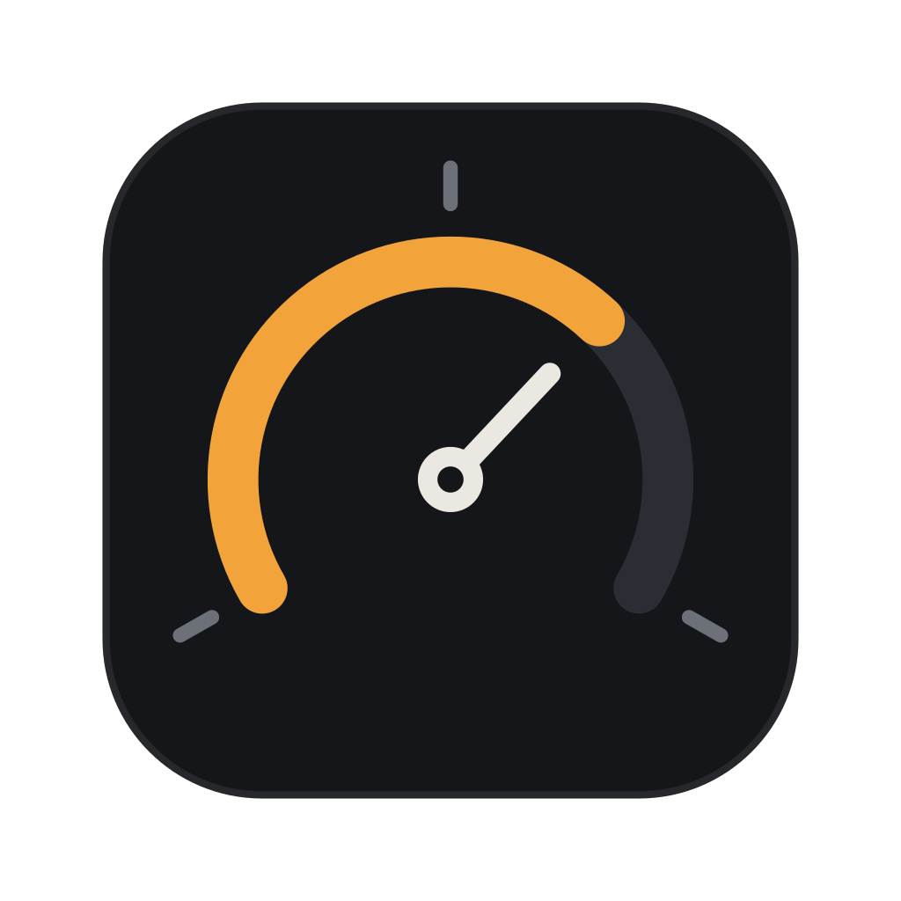

<p align="center"></p>

# System Monitor

A native macOS system monitor built with [GPUI](https://www.gpui.rs/), the UI framework behind Zed. Refreshes every second.

- Five views: Overview, Processor, Memory, Network & Disk, Processes
- CPU dial with a 2-minute history for the whole chip and for each core
- Memory and swap, thermals, storage volumes, network and disk throughput
- Traffic for each network interface, with totals since boot
- Process table sorted by any column (name, PID, CPU, memory)
- 9 themes (Graphite, Daylight, Midnight, Moss, Dusk, Tide, Ember, Sand, Frost), or follow the system light/dark setting
- Remembers your theme and view between launches

## Download

Get the latest build from the [Releases](../../releases) page.

macOS (Apple Silicon): `System-Monitor-*-macos-arm64.dmg`. Open it and drag System Monitor to Applications.
Intel Macs: build from source.

### macOS first launch

The app is ad-hoc signed, not notarized by Apple. On first launch macOS may say it cannot be verified:
right-click `System Monitor.app`, choose **Open**, then **Open** again. Or run
`xattr -dr com.apple.quarantine "/Applications/System Monitor.app"`.

## Build from source

```
cargo run --release
```

macOS needs Xcode and its Metal toolchain (`xcodebuild -downloadComponent MetalToolchain`).
`scripts/bundle-macos.sh` produces the `.app` and `.dmg` in `dist/`.

## Shortcuts

| | |
|---|---|
| Overview / Processor / Memory / Network & Disk / Processes | Cmd+1 / 2 / 3 / 4 / 5 |
| Sort processes / reverse | Click a column header / click it again |
| Close theme menu | Esc |

Settings live in `~/Library/Application Support/System Monitor/`.

## License

MIT
